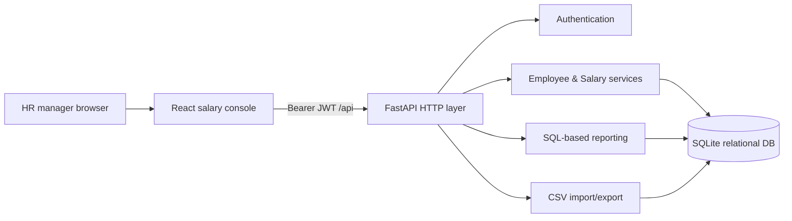

# Architecture

**Tables:** `users` (HR login); `employees` (identity, org dimensions, current annual base in minor units); `salary_revisions` (append-only updates + reason, author, effective date); `audit_events` (profile/status/import changes). `employee_code`, `email` unique; indexes on common filter fields.

**Write path:** authorization → Pydantic validation → DB transaction → employee snapshot update + salary revision insertion → commit. Failure → rollback. Reporting reads current snapshots only.

**Data safety:** All examples are synthetic. Use no real employee salary data in the demo or repository. Deployment must protect HTTPS and the server-side JWT secret.
